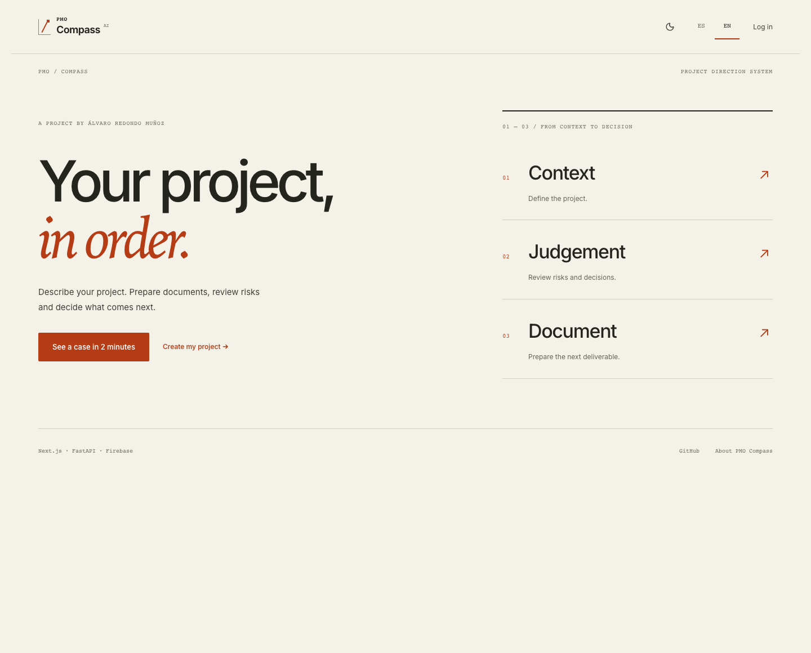

# PMO Compass AI

**Turn scattered project information into a clear view of risks, decisions and next actions.**

A full-stack PMO portfolio project by **Álvaro Redondo Muñoz** · Español / English

[Open the app](https://pmo-compass-ai.vercel.app) · [See a case in 2 minutes](https://pmo-compass-ai.vercel.app/case-study) · [My contribution](https://pmo-compass-ai.vercel.app/about#built) · [Documentation](docs/README.md)

[](https://github.com/i22remua/pmo-compass-ai/actions/workflows/ci.yml)

[](https://pmo-compass-ai.vercel.app)

## Try it in two minutes

Open the **public case** to compare fictional project information with a labelled, pre-generated risk register. Generate another document, inspect its sources and export the result. No installation, account or API key is required from visitors.

To use your own context, choose **Create my project / Crear mi proyecto**. The Starter Workspace saves work in this browser; optional examples never replace your projects. Signing in opens a separate private Firebase workspace for persistence across devices. Browser drafts are not transferred automatically.

**Public status:** deployed on Vercel. The instruction update was published on 19 October 2026. [Verification and limitations](docs/VALIDATION.md#instruction-updates--19-october-2026).

## What it demonstrates

- **Actionable PMO dashboard:** overdue actions, confirmed high risks and pending decisions, calculated from registered data and linked to the relevant records.
- **Evidence-aware diagnosis:** current situation, contradictions and recommended actions, with supplied facts, inferences and missing information distinguished. What-if results are scenarios, not predictions.
- **Project context and documents:** review excerpts from PDF, DOCX, TXT or meeting transcripts; generate eight PMO document formats in Spanish or English, then copy, export, save or compare deliveries.
- **Project lifecycle tracking:** actions, risks, versioned changes and decisions, milestone baselines, cost reviews and evidenced benefit measurements.
- **Reviewed instruction updates:** create or edit records across all four tracking areas using guided text formats. Interpretation runs in the browser; every change requires review and confirmation. [Examples and limits](docs/project-instructions.md).

## My contribution

I designed and implemented the bilingual interface, PMO workflows, TypeScript repository layer, FastAPI generation service, provider fallback, Firebase ownership rules and automated validation. The project connects product decisions with working frontend, backend and persistence behavior.

Key engineering choices include separating generation from storage, retaining evidence and version history where supported, rejecting stale tracking/control edits, and preserving unknown values instead of inventing project facts. [Architecture and tradeoffs](docs/architecture.md) · [Data model](docs/database-schema.md).

## Stack and architecture

| Layer | Technology and responsibility |
| --- | --- |
| Interface | Next.js, React, TypeScript; responsive ES/EN workspace and light/dark themes |
| Persistence | Browser localStorage or Firebase Auth + owner-scoped Firestore |
| Generation | FastAPI, Pydantic, interchangeable AI providers and an internal PMO Engine |
| Verification | Playwright, pytest, Firebase emulators, axe and GitHub Actions |
| Hosting | Vercel frontend and API; Firebase Spark |

**AI and privacy:** new projects use the internal engine. External AI requires project authorisation. The backend supports Gemini, Groq and OpenRouter free-tier configurations with automatic fallback; account eligibility and quotas still apply. Provider keys stay on the backend. “Offline PMO Engine” means no external model call: document generation still needs the API. Reviewed instruction parsing runs locally in the browser.

Generated content requires human review. Cloud failures never silently switch storage to the browser. [Security boundaries](docs/security.md) · [Data protection and encryption limits](docs/data-security.md) · [AI strategy](docs/ai-strategy.md).

## Run locally

Requirements: Node 22.13+, Python 3.11–3.13; Java 21 for Firebase emulator tests.

```bash
npm run setup
npm run dev
```

Open http://localhost:3000. No paid API is required; missing provider keys preserve the internal engine. Configure from [frontend](frontend/.env.example) and [backend](backend/.env.example) examples; never commit actual credentials.

```bash
npm run check          # ESLint, TypeScript, backend tests and production build
npm run test:e2e
npm run test:rules
npm run test:firebase
```

[All validation commands and results](docs/VALIDATION.md) · [Deployment guide](docs/deployment.md) · [Public verification checklist](docs/public-live-checklist.md) · [Product roadmap](docs/product-roadmap.md)

Firebase integration tests use emulators. Live browser checks and earlier real-account checks are recorded separately; passing an emulator test does not prove production persistence.
